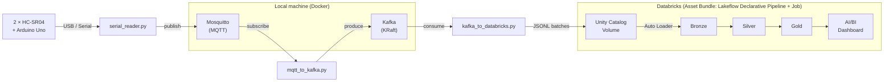
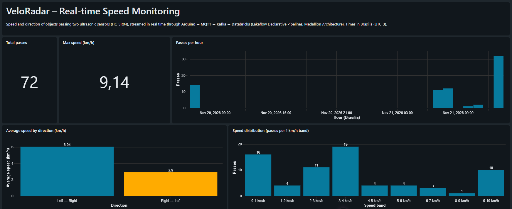
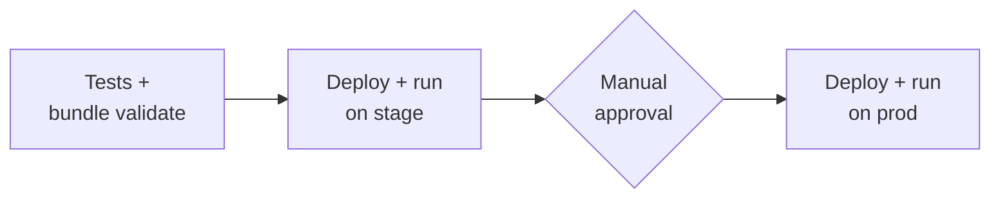

# VeloRadar – Real-time Speed Detection Pipeline

**From a toy car on my desk to a Databricks dashboard.**

VeloRadar is an end-to-end data engineering project with **IoT at the source**. Two ultrasonic sensors wired to an Arduino measure the speed and direction of objects passing in front of them. Every pass becomes a JSON event that travels through **MQTT** and **Kafka** and lands in **Databricks**, where a **Lakeflow Declarative Pipeline** processes it through a **Medallion Architecture** (bronze, silver, gold) and feeds an **AI/BI dashboard**.

The Databricks side is deployed as code with **Databricks Asset Bundles** to three environments (**dev**, **stage**, **prod**), tested with **pytest** and released by **GitHub Actions**.


---

## Architecture



| Layer | Technology | What happens |
|---|---|---|
| **Device** | Arduino Uno, 2 × HC-SR04, LCD 16x2 I2C | Detects which sensor is hit first, computes `v = d / t`, shows the speed on the LCD and writes one JSON line per pass to the serial port |
| **Edge** | Python + `pyserial` | Reads the serial port, adds a UTC timestamp (`received_at`), keeps a local backup (`events.jsonl`) and publishes to MQTT |
| **Messaging** | Mosquitto (MQTT) → Kafka | MQTT is the lightweight device protocol; Kafka stores events durably and allows replay. A Python bridge moves messages from one to the other |
| **Landing** | Python + `confluent-kafka` + `databricks-sdk` | Consumes Kafka in a consumer group, uploads JSONL batches to a Unity Catalog Volume and commits offsets only after a successful upload (at-least-once) |
| **Bronze** | Streaming table + `STREAM read_files` (Auto Loader) | Raw events, as received, plus ingestion metadata |
| **Silver** | Expectations + `AUTO CDC` | Typed, validated and deduplicated events (one row per Kafka offset) |
| **Gold** | Materialized views | Business metrics: passes per hour, speed by direction, speed distribution |
| **Serving** | Databricks AI/BI Dashboard | Published dashboard reading the **prod** gold layer |
| **Delivery** | Databricks Asset Bundles + GitHub Actions | Pipeline and job deployed as code to dev, stage and prod |

---

## The Lakehouse


The SQL files never mention a catalog. Tables are written as `bronze.events`, `silver.events` and `gold.*`, and the catalog comes from the bundle target (`veloradar_dev`, `veloradar_stage` or `veloradar_prod`). The landing Volume path arrives as the pipeline parameter `${source_path}`.

### Bronze – `bronze.events` ([`01_bronze.sql`](transformations/01_bronze.sql))
A streaming table fed by **Auto Loader** (`STREAM read_files`) reading the landing Volume. It keeps every event exactly as received and adds `source_file`, `source_file_modified_at` and `ingested_at`. Auto Loader tracks which files were already processed, so each run only ingests new files.

### Silver – `silver.events` ([`02_silver.sql`](transformations/02_silver.sql))
- **Typing:** `received_at` (string) becomes `event_time` (timestamp); numeric fields get explicit types
- **Business-friendly names:** `kafka_key` → `device_id`, `id` → `device_pass_seq`
- **Data quality with expectations** (rows that fail are dropped and counted):
  - `speed_kmh > 0`
  - `elapsed_ms > 0`
  - `direction IN ('right_to_left', 'left_to_right')`
  - `event_time IS NOT NULL`
- **Deduplication with `AUTO CDC`** keyed on `(kafka_partition, kafka_offset)`. The uploader is at-least-once, so a batch may arrive twice; the Kafka offset is the natural unique key. The device counter (`id`) is not used as a key because it resets whenever the Arduino reboots.

### Gold – `gold.*` ([`03_gold.sql`](transformations/03_gold.sql))
| Materialized view | Answers |
|---|---|
| `passes_by_hour` | How many passes, average and max speed per hour (Brasília local time, `TIMESTAMP_NTZ`) |
| `speed_by_direction` | Pass count and speed statistics per direction |
| `speed_distribution` | Number of passes per 1 km/h speed band |

---

## Dashboard



The dashboard reads **only the prod gold layer**. It has no knowledge of JSON, Kafka offsets or deduplication: that is the job of the layers below it. Its definition is versioned in [`dashboard/veloradar_dashboard.lvdash.json`](dashboard/veloradar_dashboard.lvdash.json).

---

## Environments and deployment

The bundle ([`databricks.yml`](databricks.yml)) defines two variables, `catalog` and `source_path`, and three targets:

| Target | Catalog | Deployed by | Resource names | Schedule |
|---|---|---|---|---|
| **dev** | `veloradar_dev` | Developer, from the CLI | `[dev <user>] veloradar_pipeline_dev` / `veloradar_job_dev` | Paused |
| **stage** | `veloradar_stage` | GitHub Actions, on every push to `main` | `veloradar_pipeline_stage` / `veloradar_job_stage` | Paused |
| **prod** | `veloradar_prod` | GitHub Actions, after stage succeeds and a manual approval | `veloradar_pipeline_prod` / `veloradar_job_prod` | Paused |

Resources live in [`resources/`](resources/):
- [`veloradar.pipeline.yml`](resources/veloradar.pipeline.yml): serverless Lakeflow Declarative Pipeline (triggered mode) that includes every file in `transformations/`
- [`veloradar.job.yml`](resources/veloradar.job.yml): job that refreshes the pipeline every 15 minutes (`0 0/15 * * * ?`, America/Sao_Paulo). The schedule is **paused** on every target to protect the Databricks Free Edition quota; switch `pause_status` to `UNPAUSED` to turn it on

### CI/CD ([`.github/workflows/ci-cd.yml`](.github/workflows/ci-cd.yml))



- **Pull request:** pytest, then `bundle validate` for stage and prod. Nothing is deployed
- **Push to `main`:** tests → validate → deploy and run the job on **stage** → wait for approval → deploy and run the job on **prod**. If stage fails, prod is not touched
- **Secrets:** `DATABRICKS_HOST` and `DATABRICKS_TOKEN`, stored as GitHub repository secrets. GitHub environments are named `stage` and `prod`, the same as the bundle targets; `prod` requires a reviewer

### Tests ([`tests/`](tests/))

97 tests run on every push and pull request:

| File | What it protects |
|---|---|
| `test_sample_events.py` | Every sample event has the expected fields and types, passes the same rules as the silver expectations, has a direction consistent with the first sensor hit, and has a speed consistent with physics (`v = d / t`) |
| `test_transformations.py` | No hardcoded catalog in the SQL, bronze reads `${source_path}`, silver keeps its four expectations and deduplicates on the Kafka offset, gold defines its three materialized views |
| `test_bundle_config.py` | dev, stage and prod exist, each target points to its own catalog and Volume, only dev is in development mode, the pipeline is serverless and parameterized, the job schedule stays paused |

---

## Event schema

One JSON line per pass, as produced by the Arduino and enriched along the pipeline:

```json
{
  "event": "pass",
  "id": 1,
  "start_sensor": 1,
  "direction": "right_to_left",
  "elapsed_ms": 111,
  "distance_cm": 16.0,
  "speed_kmh": 5.19,
  "received_at": "2026-11-20T10:39:37.057768+00:00",
  "kafka_key": "radar-01",
  "kafka_partition": 0,
  "kafka_offset": 0
}
```

| Field | Added by |
|---|---|
| `event`, `id`, `start_sensor`, `direction`, `elapsed_ms`, `distance_cm`, `speed_kmh` | Arduino |
| `received_at` | `serial_reader.py` |
| `kafka_key`, `kafka_partition`, `kafka_offset` | `kafka_to_databricks.py` |

A sample is available in [`sample_data/sample_events.jsonl`](sample_data/sample_events.jsonl).

---

## Repository structure

```
veloradar/
├── .github/workflows/ci-cd.yml        # Tests, validate, deploy stage, approval, deploy prod
├── databricks.yml                     # Bundle: variables and dev / stage / prod targets
├── resources/
│   ├── veloradar.pipeline.yml         # Lakeflow Declarative Pipeline (serverless)
│   └── veloradar.job.yml              # Job that refreshes the pipeline (schedule paused)
├── transformations/
│   ├── 01_bronze.sql                  # Auto Loader → bronze.events
│   ├── 02_silver.sql                  # Expectations + AUTO CDC → silver.events
│   └── 03_gold.sql                    # Materialized views → gold.*
├── setup/00_setup.sql                 # Catalogs, schemas and landing Volumes for each environment
├── dashboard/veloradar_dashboard.lvdash.json
├── src/
│   ├── serial_reader.py               # Serial → MQTT (+ local JSONL backup)
│   ├── mqtt_to_kafka.py               # MQTT → Kafka bridge
│   └── kafka_to_databricks.py         # Kafka → Unity Catalog Volume (JSONL batches)
├── tests/                             # pytest suite (97 tests)
├── arduino/VeloRadar_v2/VeloRadar_v2.ino
├── docker/
│   ├── docker-compose.yml             # Mosquitto + Kafka (KRaft, single node)
│   └── mosquitto/mosquitto.conf
├── sample_data/sample_events.jsonl
├── docs/images/
├── requirements.txt                   # Runtime dependencies of the edge scripts
├── requirements-dev.txt               # Test dependencies
└── pytest.ini
```

---

## How to run it

### 1. Hardware
- Arduino Uno, 2 × HC-SR04, LCD 16x2 with I2C module, 830-point breadboard, jumpers
- Wiring: right sensor `Trig 9 / Echo 10`, left sensor `Trig 11 / Echo 12`, LCD `SDA A4 / SCL A5`
- Install the **LiquidCrystal I2C** library (Frank de Brabander) and upload `VeloRadar_v2.ino` with the Arduino IDE
- Set `SENSOR_DISTANCE_CM` to the real distance between the two sensors

### 2. Local infrastructure
```bash
cd docker
docker compose up -d
docker exec kafka /opt/kafka/bin/kafka-topics.sh --create --topic veloradar-events \
  --bootstrap-server localhost:9092 --partitions 1 --replication-factor 1
```

### 3. Databricks
1. Run [`setup/00_setup.sql`](setup/00_setup.sql) once in the SQL Editor (creates `veloradar_dev`, `veloradar_stage` and `veloradar_prod`)
2. Install the Databricks CLI and authenticate with a personal access token:
   ```bash
   export DATABRICKS_HOST="https://<your-workspace>.cloud.databricks.com"
   export DATABRICKS_TOKEN="<your-token>"
   ```
3. Validate, deploy and run the dev target:
   ```bash
   databricks bundle validate -t dev
   databricks bundle deploy   -t dev
   databricks bundle run      -t dev veloradar_job
   ```
4. Import [`dashboard/veloradar_dashboard.lvdash.json`](dashboard/veloradar_dashboard.lvdash.json)

Stage and prod are deployed by GitHub Actions, never by hand.

### 4. Edge services
```bash
pip install -r requirements.txt

python src/mqtt_to_kafka.py          # terminal 1
python src/kafka_to_databricks.py    # terminal 2
python src/serial_reader.py          # terminal 3 (adjust the COM port)
```

`kafka_to_databricks.py` uploads to the **dev** landing Volume by default. To send events to another environment, set `VELORADAR_VOLUME_PATH`, for example `/Volumes/veloradar_prod/landing/events`.

### 5. Tests
```bash
pip install -r requirements-dev.txt
python -m pytest
```

---

## Design decisions and honest limitations

- **Why MQTT and Kafka for a single sensor?** Strictly, one Arduino could upload straight to Databricks. MQTT and Kafka are here to show the architecture of a real IoT system: MQTT is the protocol devices actually speak, and Kafka adds durability, replay and multiple independent consumers. The same design scales to many devices.
- **Why files in a Volume instead of reading Kafka directly?** Databricks Free Edition restricts outbound network access, so it cannot reach a Kafka broker on a home network. The uploader pushes batches into a Volume and Auto Loader picks them up. Version 2 replaces this with a cloud Kafka endpoint.
- **Near real-time, not real-time.** Events reach Kafka in under a second, but the uploader batches up to 30 seconds and the pipeline runs on demand or on a schedule (triggered mode).
- **Measurement ceiling.** The shortest time the Arduino loop can measure between the two sensors is about 63 ms. With the sensors 16 cm apart, that caps the measurable speed at about **9.14 km/h**: anything faster is recorded at that ceiling. Increasing the sensor distance or reducing loop delays raises the limit.
- **Device counter resets.** The Arduino `id` restarts at 1 on every reboot, which is why deduplication uses the Kafka offset.
- **One radar, three environments.** The radar feeds dev through the uploader. Stage and prod were seeded with a copy of the same landing files, so every environment runs the full pipeline on real data.

---

## Roadmap

- [x] **Databricks Asset Bundles** with dev, stage and prod targets
- [x] **CI/CD** with GitHub Actions, pytest and a manual approval for prod
- [ ] **v2 – Cloud ingestion:** Azure Event Hubs (Kafka endpoint) + Azure Databricks, reading Kafka directly
- [ ] **ESP32 with Wi-Fi** publishing straight to MQTT, removing the serial bridge
- [ ] **Automated startup** of the bridge and uploader as Docker services
- [ ] **Dashboard in the bundle**, deployed per environment
- [ ] **ML:** anomaly detection and pass-volume forecasting
- [ ] **AI:** natural-language questions over the gold layer with an AI agent

---

## Author

**Cleber Souza** – Senior Data Engineer
[LinkedIn](https://www.linkedin.com/in/houston-c/) · [GitHub](https://github.com/cleberzumba) · [Portfolio](https://datascienceportfol.io/CleberZumbaSouza)
