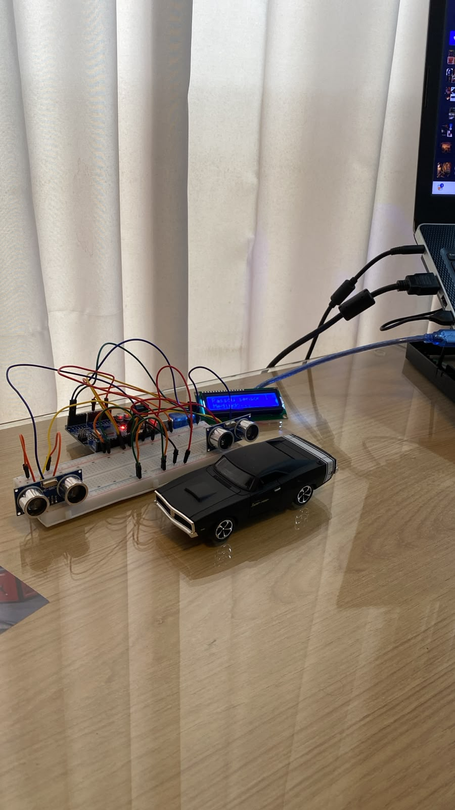
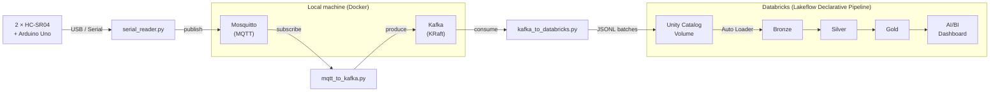
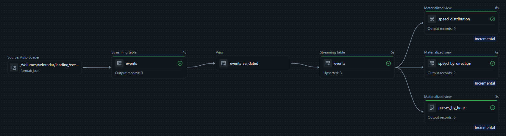

# VeloRadar – Real-time Speed Detection Pipeline

**From a toy car on my desk to a Databricks dashboard.**

VeloRadar is an end-to-end data engineering project with **IoT at the source**. Two ultrasonic sensors wired to an Arduino measure the speed and direction of objects passing in front of them. Every pass becomes a JSON event that travels through **MQTT** and **Kafka** and lands in **Databricks**, where a **Lakeflow Declarative Pipeline** processes it through a **Medallion Architecture** (bronze, silver, gold) and feeds an **AI/BI dashboard**.



---

## Architecture



| Layer | Technology | What happens |
|---|---|---|
| **Device** | Arduino Uno, 2 × HC-SR04, LCD 16x2 I2C | Detects which sensor is hit first, computes `v = d / t`, shows the speed on the LCD and writes one JSON line per pass to the serial port |
| **Edge** | Python + `pyserial` | Reads the serial port, adds a UTC timestamp (`received_at`), keeps a local backup (`events.jsonl`) and publishes to MQTT |
| **Messaging** | Mosquitto (MQTT) → Kafka | MQTT is the lightweight device protocol; Kafka stores events durably and allows replay. A Python bridge moves messages from one to the other |
| **Landing** | Python + `confluent-kafka` + `databricks-sdk` | Consumes Kafka in a consumer group, uploads JSONL batches to a Unity Catalog Volume and commits offsets only after a successful upload (at-least-once) |
| **Bronze** | Streaming table + `STREAM read_files` (Auto Loader) | Raw events, as received, plus ingestion metadata |
| **Silver** | Expectations + `AUTO CDC` | Typed, validated and deduplicated events (one row per Kafka offset) |
| **Gold** | Materialized views | Business metrics: passes per hour, speed by direction, speed distribution |
| **Serving** | Databricks AI/BI Dashboard | Published dashboard for business users |

---

## The Lakehouse



### Bronze – `veloradar.bronze.events`
A streaming table fed by **Auto Loader** (`STREAM read_files`) reading the landing Volume. It keeps every event exactly as received and adds `source_file`, `source_file_modified_at` and `ingested_at`. Auto Loader tracks which files were already processed, so each run only ingests new files.

### Silver – `veloradar.silver.events`
- **Typing:** `received_at` (string) becomes `event_time` (timestamp); numeric fields get explicit types
- **Business-friendly names:** `kafka_key` → `device_id`, `id` → `device_pass_seq`
- **Data quality with expectations** (rows that fail are dropped and counted):
  - `speed_kmh > 0`
  - `elapsed_ms > 0`
  - `direction IN ('right_to_left', 'left_to_right')`
  - `event_time IS NOT NULL`
- **Deduplication with `AUTO CDC`** keyed on `(kafka_partition, kafka_offset)`. The uploader is at-least-once, so a batch may arrive twice; the Kafka offset is the natural unique key. The device counter (`id`) is not used as a key because it resets whenever the Arduino reboots.

### Gold – `veloradar.gold.*`
| Materialized view | Answers |
|---|---|
| `passes_by_hour` | How many passes, average and max speed per hour (Brasília local time, `TIMESTAMP_NTZ`) |
| `speed_by_direction` | Pass count and speed statistics per direction |
| `speed_distribution` | Number of passes per 1 km/h speed band |

---

## Dashboard


The dashboard reads **only the gold layer**. It has no knowledge of JSON, Kafka offsets or deduplication: that is the job of the layers below it.

---

## Event schema

One JSON line per pass, as produced by the Arduino and enriched along the pipeline:

```json
{
  "event": "pass",
  "id": 1,
  "start_sensor": 1,
  "direction": "right_to_left",
  "elapsed_ms": 111,
  "distance_cm": 16.0,
  "speed_kmh": 5.19,
  "received_at": "2026-11-20T10:39:37.057768+00:00",
  "kafka_key": "radar-01",
  "kafka_partition": 0,
  "kafka_offset": 0
}
```

| Field | Added by |
|---|---|
| `event`, `id`, `start_sensor`, `direction`, `elapsed_ms`, `distance_cm`, `speed_kmh` | Arduino |
| `received_at` | `serial_reader.py` |
| `kafka_key`, `kafka_partition`, `kafka_offset` | `kafka_to_databricks.py` |

A sample is available in [`data/sample_events.jsonl`](data/sample_events.jsonl).

---

## Repository structure

```
veloradar/
├── arduino/VeloRadar_v2/VeloRadar_v2.ino   # Sensors, speed calculation, LCD, JSON output
├── python/
│   ├── serial_reader.py                     # Serial → MQTT (+ local JSONL backup)
│   ├── mqtt_to_kafka.py                     # MQTT → Kafka bridge
│   ├── kafka_to_databricks.py               # Kafka → Unity Catalog Volume (JSONL batches)
│   └── requirements.txt
├── docker/
│   ├── docker-compose.yml                   # Mosquitto + Kafka (KRaft, single node)
│   └── mosquitto/mosquitto.conf
├── databricks/
│   ├── setup.sql                            # Catalog, schemas and landing Volume
│   ├── pipeline/
│   │   ├── bronze_events.sql
│   │   ├── silver_events.sql
│   │   └── gold_metrics.sql
│   └── dashboard/veloradar_dashboard.lvdash.json
├── data/sample_events.jsonl
└── docs/images/
```

---

## How to run it

### 1. Hardware
- Arduino Uno, 2 × HC-SR04, LCD 16x2 with I2C module, 830-point breadboard, jumpers
- Wiring: right sensor `Trig 9 / Echo 10`, left sensor `Trig 11 / Echo 12`, LCD `SDA A4 / SCL A5`
- Install the **LiquidCrystal I2C** library (Frank de Brabander) and upload `VeloRadar_v2.ino` with the Arduino IDE
- Set `SENSOR_DISTANCE_CM` to the real distance between the two sensors

### 2. Local infrastructure
```bash
cd docker
docker compose up -d
docker exec kafka /opt/kafka/bin/kafka-topics.sh --create --topic veloradar-events \
  --bootstrap-server localhost:9092 --partitions 1 --replication-factor 1
```

### 3. Databricks
1. Run `databricks/setup.sql` in the SQL Editor
2. Create an ETL pipeline (default catalog `veloradar`, default schema `bronze`) and add the three files from `databricks/pipeline/`
3. Import `databricks/dashboard/veloradar_dashboard.lvdash.json`
4. Create a personal access token and set it as environment variables (never in the code):
   ```bash
   export DATABRICKS_HOST="https://<your-workspace>.cloud.databricks.com"
   export DATABRICKS_TOKEN="<your-token>"
   ```

### 4. Python services
```bash
pip install -r python/requirements.txt

python python/mqtt_to_kafka.py          # terminal 1
python python/kafka_to_databricks.py    # terminal 2
python python/serial_reader.py          # terminal 3 (adjust the COM port)
```

Pass something in front of the sensors, run the pipeline and refresh the dashboard.

---

## Design decisions and honest limitations

- **Why MQTT and Kafka for a single sensor?** Strictly, one Arduino could upload straight to Databricks. MQTT and Kafka are here to show the architecture of a real IoT system: MQTT is the protocol devices actually speak, and Kafka adds durability, replay and multiple independent consumers. The same design scales to many devices.
- **Why files in a Volume instead of reading Kafka directly?** Databricks Free Edition restricts outbound network access, so it cannot reach a Kafka broker on a home network. The uploader pushes batches into a Volume and Auto Loader picks them up. Version 2 replaces this with a cloud Kafka endpoint.
- **Near real-time, not real-time.** Events reach Kafka in under a second, but the uploader batches up to 30 seconds and the pipeline runs on a schedule (triggered mode).
- **Measurement ceiling.** The shortest time the Arduino loop can measure between the two sensors is about 63 ms. With the sensors 16 cm apart, that caps the measurable speed at about **9.14 km/h**: anything faster is recorded at that ceiling. Increasing the sensor distance or reducing loop delays raises the limit.
- **Device counter resets.** The Arduino `id` restarts at 1 on every reboot, which is why deduplication uses the Kafka offset.

---

## Roadmap

- [ ] **v2 – Cloud ingestion:** Azure Event Hubs (Kafka endpoint) + Azure Databricks, reading Kafka directly
- [ ] **ESP32 with Wi-Fi** publishing straight to MQTT, removing the serial bridge
- [ ] **Automated startup** of the bridge and uploader as Docker services
- [ ] **ML:** anomaly detection and pass-volume forecasting
- [ ] **AI:** natural-language questions over the gold layer with an AI agent

---

## Author

**Cleber Souza** – Senior Data Engineer
[LinkedIn](https://www.linkedin.com/in/houston-c/) · [GitHub](https://github.com/cleberzumba) · [Portfolio](https://datascienceportfol.io/CleberZumbaSouza)
